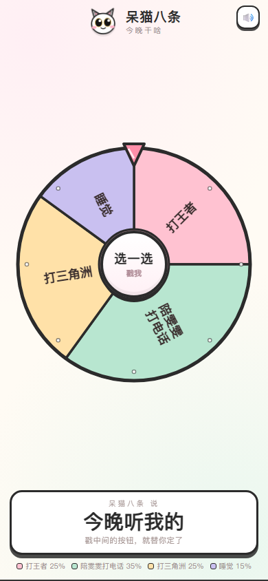

# 呆猫八条 · 今晚干啥

一个给今晚做决定的转盘。点「选一选」，转盘转起来，最后停在某个选项上。



## 选项与概率

随机数取自 `[0, 1)`，按区间落到四个选项上；转盘扇区面积也按同一比例绘制，所以指针停在哪和抽到哪始终一致。

| 随机数区间 | 结果 | 概率 |
| --- | --- | --- |
| 0 – 0.25 | 打王者 | 25% |
| 0.25 – 0.6 | 陪雯雯打电话 | 35% |
| 0.6 – 0.85 | 打三角洲 | 25% |
| 0.85 – 1 | 睡觉 | 15% |

## 特点

- **单文件**：整个应用就是一个 `index.html`，没有任何外部依赖，断网也能用
- **手机优先**：竖屏铺满、不滚动，适配刘海屏安全区
- **有反馈**：转动音效、落定三音、震动（可静音，设置会记住）
- **可安装**：iOS/Android 均可「添加到主屏幕」

## 本地打开

双击 `index.html` 即可，不需要服务器。

## 放在网上

1. 新建仓库并上传 `index.html`
2. Settings → Pages → Source 选 `Deploy from a branch`，Branch 选 `main`、目录 `/ (root)`，保存
3. 等一两分钟，访问 `https://<用户名>.github.io/<仓库名>/`

微信里发这个链接，对方点开就能用。

## 改选项

打开 `index.html`，找到这段：

```js
var OPTIONS = [
  { full: '打王者',       color: '#FFC2D1', hint: '开黑走起，上号！' },
  ...
];
var PROB = [0.25, 0.35, 0.25, 0.15];
```

`OPTIONS` 改文案和颜色，`PROB` 改概率（四个加起来要是 1）。注意 `decide()` 函数里的区间判断也要跟着改成一样的数。
